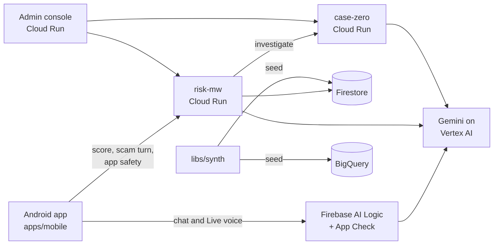

# FinNest

FinNest is a prototype digital bank for Bangladesh. It stops mobile-finance scams at the moment
they work: while a fraudster is on the phone and the customer is about to send money.

The Android app reads the risk signals around a transfer (an active call, a recent SIM change,
screen sharing, unusual typing, a risky app on the phone). The backend scores the transfer and the
payee. When the risk is high, the app holds the money and explains why, calmly, in Bangla or
English. The FinNest Assistant answers safety questions by text or voice, summarises a suspicious
call and tells the customer what to do next. Operators see every score and case in the admin
console, and an investigator agent drafts a cited case file for each flagged account.

Built for the Google Cloud AI Builder Cup 2026. Every person, account and transaction in this
repository is synthetic.

## What it does

| Feature | Where |
|---|---|
| Transfer risk scoring: rules, payee mule score, behaviour, app safety, live call signals | `services/risk-mw` |
| Hold and explain: the server's reason, shown and spoken in Bangla or English | `apps/mobile`, `services/risk-mw` |
| Scam-call check: Gemini classifies what the caller says, turn by turn | `services/risk-mw` |
| App Safety Check: rules, a permission classifier, Play Integrity and Gemini triage | `libs/app-safety-check`, `services/risk-mw` |
| FinNest Assistant: text chat and Gemini Live voice, grounded in an on-device knowledge base | `apps/mobile` |
| Investigator agent: Gemini tool calls over the transaction graph, with every claim checked | `services/case-zero` |
| Operator console: scores, cases, campaigns and model metrics | `apps/console` |
| Synthetic world: customers, SIMs, devices, transactions and mule rings with a fixed seed | `libs/synth`, `data` |

## Architecture



More detail, including the transfer sequence: [`docs/architecture.md`](docs/architecture.md).

## Google Cloud and AI

| Service | Use |
|---|---|
| Vertex AI Gemini 3.8 Flash | Assistant chat, the investigator's tool-calling loop, caller transcription |
| Vertex AI Gemini 3.5 Flash-Lite | Per-turn scam classification, App Safety triage, warning text |
| Vertex AI Gemini 3.8 Live | Assistant voice (16 kHz in, 24 kHz out) and live caller transcription |
| Vertex AI Gemini TTS | Spoken warnings in Bangla and English |
| Firebase AI Logic and App Check | The app calls Gemini directly, with App Check (Play Integrity) protecting the calls |
| Cloud Run | `risk-mw`, `case-zero` and the admin console |
| Firestore | Audit trail, demo state, accounts and transactions |
| BigQuery | The synthetic world for analysis |

Model ids and prices live in one file: `services/risk-mw/config/models.yaml`.

## Repository layout

```
apps/
  mobile/            Flutter Android app (FinNest, with the FinNest Assistant)
  console/           Operator console: FastAPI API and React web app
services/
  risk-mw/           Risk middleware: FastAPI on Cloud Run
  case-zero/         Investigator agent service
libs/
  synth/             Synthetic world generator, graph tools, mule scorer
  app-safety-check/  App-safety rules, permission classifier, Play Integrity
  ato/               Behaviour (account-takeover) features and models
  radar/             Offline scam-campaign radar
eval/                Cross-component evaluation runner
data/                Generated synthetic worlds (seed 42)
models/              Trained model files that the services load
design-system/       FinNest brand tokens, fonts and web CSS
docs/                Architecture and evaluation guide
```

Every component has its own README with configuration, run, test and deploy steps.

## Quick start

Requirements: Python 3.12, Node 20 (console), Flutter 3.47.7 through FVM, JDK 17 and Android SDK 36 (app).

Run the backend locally in demo mode. Demo mode needs no cloud account: Gemini, Firestore and
token checks are off, and stubs answer.

```bash
python3.12 -m venv .venv && source .venv/bin/activate
pip install -r services/risk-mw/requirements.txt -r services/risk-mw/requirements-dev.txt
cd services/risk-mw
uvicorn main:app --port 8080
```

Score a transfer during a scam call:

```bash
curl -s -X POST localhost:8080/v1/risk/score \
  -H 'Content-Type: application/json' \
  -d '{"user_id":"rina","session_id":"s1","txn":{"type":"pin_reset"},"demo_flags":{"call_active":true,"sim_swap":true}}'
```

Build the app against that backend (an emulator reaches the host at `10.0.2.2`):

```bash
cd apps/mobile
make deps
make build-debug
```

The assistant's chat and voice need a Firebase project with Firebase AI Logic. Without one, the
app runs in local demo mode and the assistant answers from its on-device knowledge base. See
[`apps/mobile/README.md`](apps/mobile/README.md).

## Tests and evaluation

Each component has a test suite. [`docs/evaluation.md`](docs/evaluation.md) lists the acceptance
criteria for this repository and the expected results. Run every check with:

```bash
scripts/verify.sh
```

## Data and models

- All data is generated by `libs/synth` with seed 42. No row describes a real person or business.
- The app permission classifier is trained on the LAMDA dataset (MIT licence). The dataset is not
  redistributed.
- The behaviour models are trained on the HMOG research dataset. They are not redistributed;
  `models/README.md` explains how to train them.

## Security

See [`SECURITY.md`](SECURITY.md). No credentials are committed. Each component reads its
configuration from environment variables; the `.env.example` files list them.

## Licence

Copyright 2026 the FinNest team. All rights reserved. No licence is granted to copy, modify or
distribute this code.
