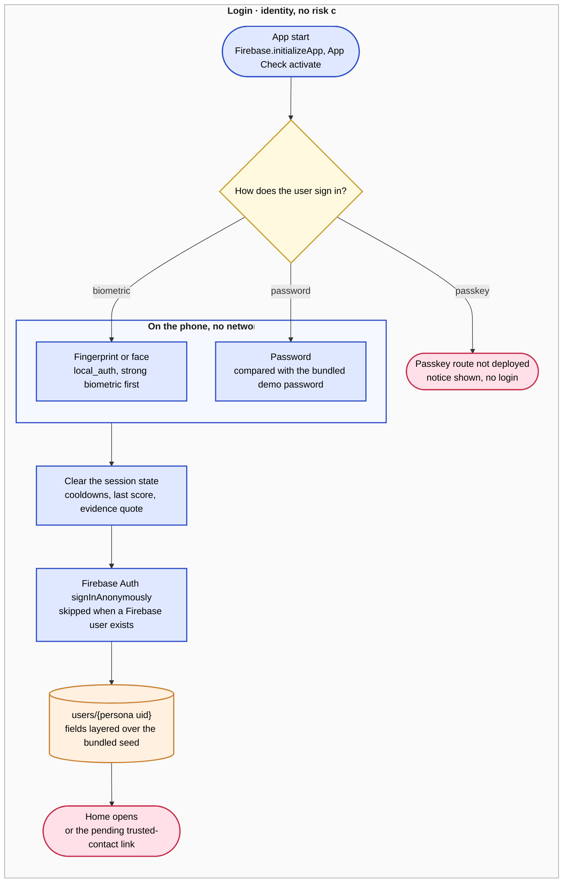
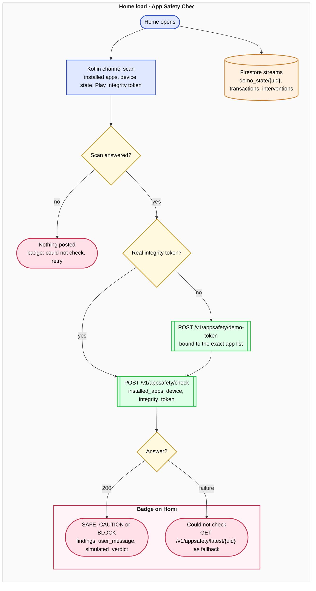
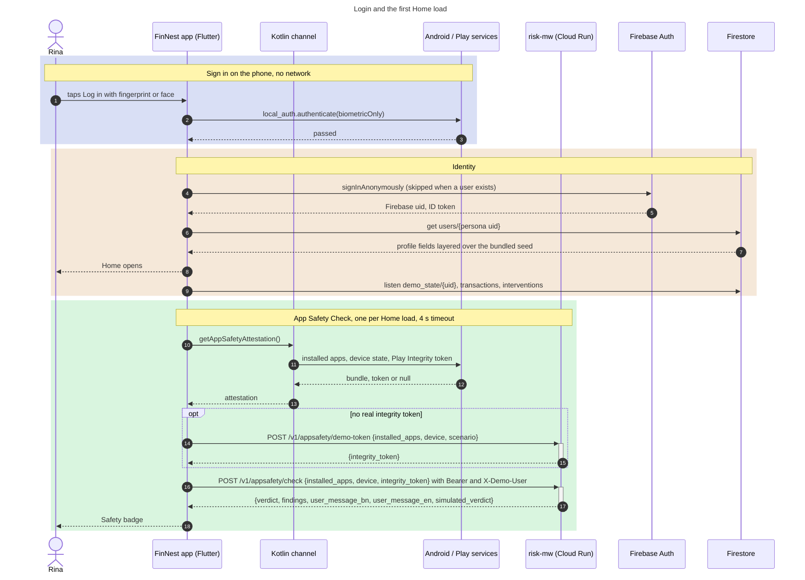
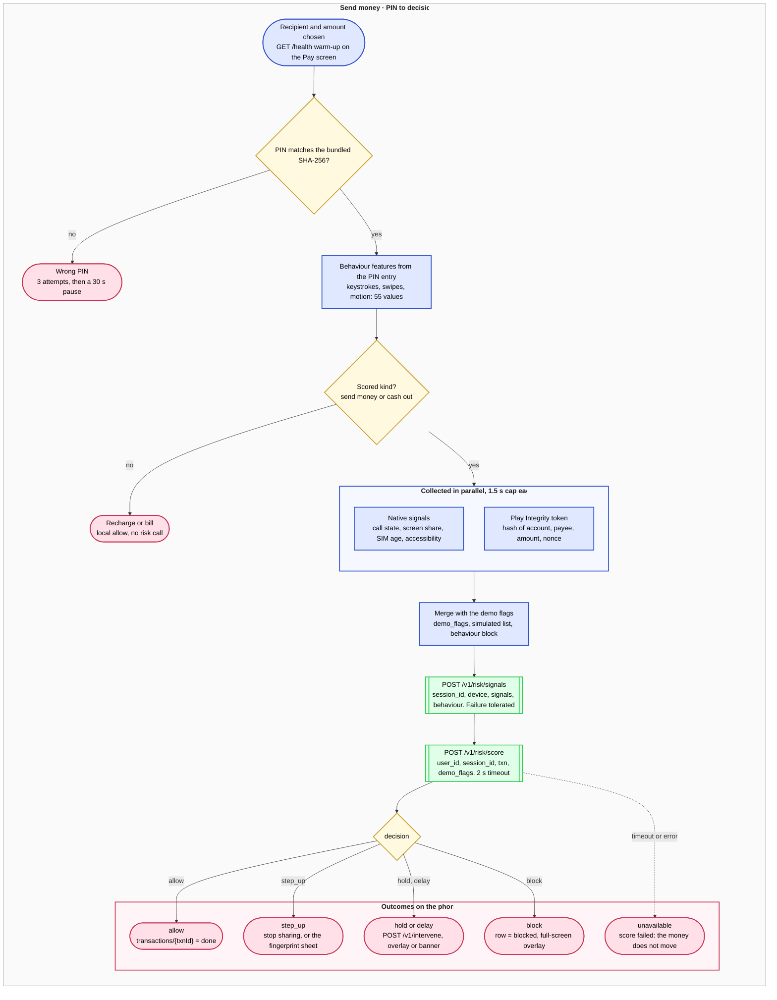
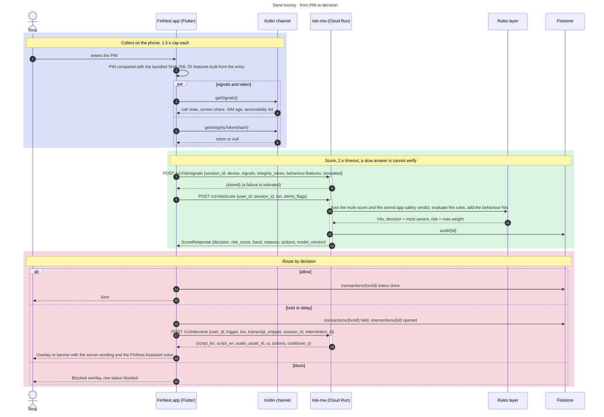
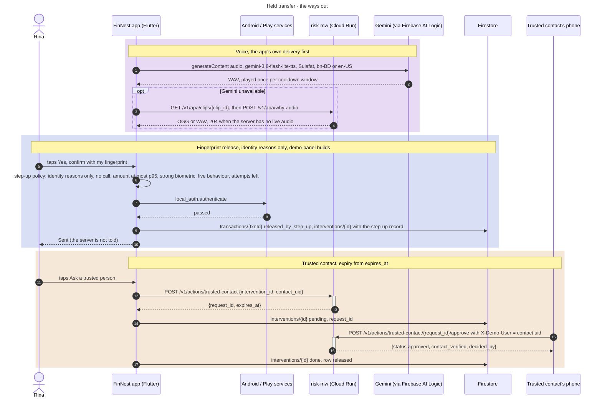
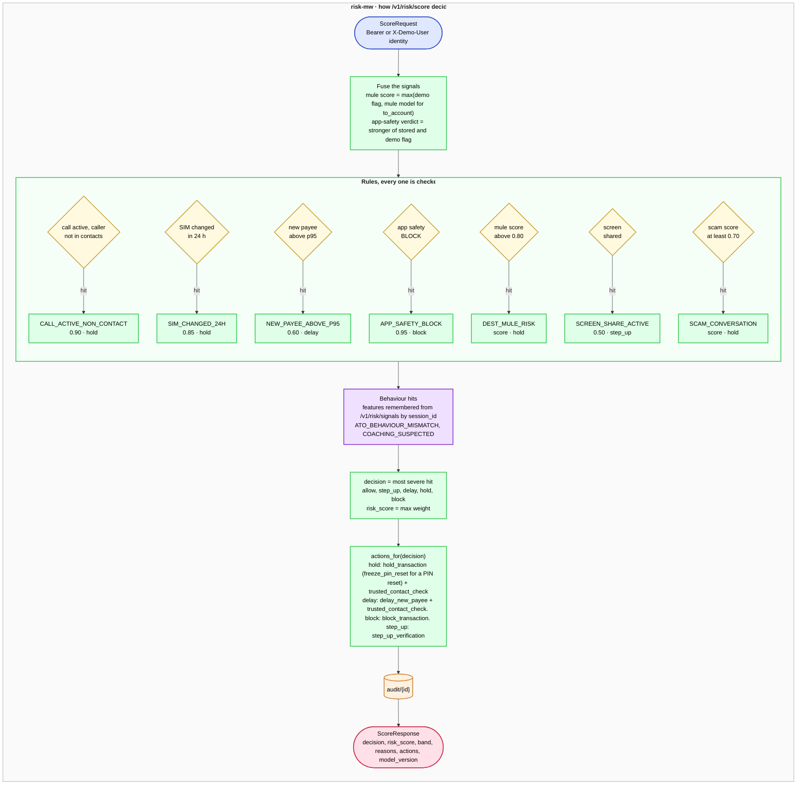

# FinNest app: API call flow

This document describes which calls the FinNest app makes, when it makes them, and how the
decision chain works. It covers three paths: login, the first Home load, and a send-money
transaction. The source of truth is the code under `apps/mobile/lib/` and
`services/risk-mw/app/`. File paths below are relative to `apps/mobile/` unless a path starts
with `services/`.

risk-mw also composes spoken lines with per-line clip tokens and serves `/v1/apa/why-audio`.
The route table and the diagrams describe the contract the app codes
against. Where the app tolerates a missing route, the text says so.

## 1. Who the app talks to

| System | Transport | Identity sent | Purpose |
|---|---|---|---|
| risk-mw (Cloud Run) | HTTPS, dio, base URL `AppEnv.riskApiBaseUrl` | `Authorization: Bearer <Firebase ID token>` and `X-Demo-User: <persona uid>` on every request | Risk decisions, app-safety verdicts, intervention copy, trusted-contact actions, Case Zero, server audio |
| Firebase Auth | SDK | anonymous sign-in | A Firebase uid and an ID token |
| Firestore | SDK | the Firebase session | `users/{uid}`, `demo_state/{uid}`, `transactions/{txnId}`, `interventions/{id}` |
| Firebase App Check | SDK | debug provider in debug builds, Play Integrity in release | App attestation for Firebase. risk-mw in demo mode does not check it |
| Vertex AI through Firebase AI Logic | SDK, `location: global` | the Firebase session | Gemini TTS for the FinNest Assistant voice. Gemini text for the chat when configured |
| Android, through the Kotlin channel | platform channel | none | Device signals, installed-app scan, Play Integrity token |
| local_auth | plugin | none | Fingerprint or face prompts. Nothing leaves the phone |

The identity headers come from `lib/data/api/identity_headers.dart`. The server runs with
`RISK_API_AUTH_REQUIRED=false` today, so it trusts the `X-Demo-User` header. The approve screen
and the Fraud desk override that header for one call each. The bearer token stays unchanged.

### 1.1 Route table

| Route | Caller | When | Timeout | On failure |
|---|---|---|---|---|
| `GET /health` | `pay_start_screen.dart` | The Pay screen opens for a scored kind | default | Ignored. Warm-up only |
| `POST /v1/appsafety/demo-token` | `app_safety_flow.dart` | Home load, when the phone has no real Play Integrity token | 4 s | The check runs with `integrity_token: null` |
| `POST /v1/appsafety/check` | `app_safety_flow.dart` | Every Home load, every return from an uninstall, every manual retry | 4 s | Badge shows "could not check". The app then calls `latest` |
| `GET /v1/appsafety/latest/{uid}` | `app_safety_flow.dart` | Only after a failed check | 2 s | Badge stays on "could not check" |
| `POST /v1/risk/signals` | `risk_flow.dart` step 5 | After the PIN, before the score | 1.5 s native cap, default HTTP | Logged. The flow continues |
| `POST /v1/risk/score` | `risk_flow.dart` step 6 | After signals. Carries `app_safety`, the last App Safety Check | 2 s | `Unavailable`. The money does not move |
| `POST /v1/intervene` | `risk_flow.dart` step 7 | Only when the decision is `hold` or `delay` | 4 s | The predicted clip and the score reasons stand. Cooldown 300 s |
| `POST /v1/actions/trusted-contact` | `trusted_contact_flow.dart` | The user asks a trusted person from the overlay | default | Overlay shows the failure line |
| `POST /v1/actions/trusted-contact/{id}/approve` or `/decline` | `trusted_contact_flow.dart` | The trusted contact taps approve or decline | default | 404 for an unknown request id |
| `GET /v1/apa/clips/{clip_id}` | `apa_voice.dart` | A served line names a clip and the app's own Gemini delivery did not play | 4 s | Next source in the voice chain |
| `POST /v1/apa/why-audio` | `apa_voice.dart` | A served line has no clip | 10 s | 204 means no live audio. 429 carries `Retry-After` |
| `POST /v1/scam/turn` | `apa_controller.dart` | The user pastes a caller's words into the FinNest Assistant | 6 s | Chat shows "check failed". No score change |
| `POST /v1/apa/turn` | `apa_text_service.dart` | Chat text, as the last resort after Gemini and the offline guide | 8 s | Chat shows the offline answer |
| `POST /v1/investigate`, `GET /v1/investigations/{case_id}` | `fraud_desk_providers.dart`, `case_screen.dart` | Fraud desk only, `AppEnv.demoPanel` builds | 10 s | 502 unavailable, 429 rate limited, 404 not found |

The exact request and response schemas are in `api-reference.md`. Routes are declared in `lib/data/api/risk_api.dart`. Every call returns a parsed response or
throws an `ApiFailure`. The app never composes its own sentence about why money was stopped. It
renders `text_bn`, `text_en`, `script_bn` and `script_en` as the server sent them (FR-3).

## 2. Login

### 2.1 What happens

1. The app starts. `firebase_bootstrap.dart` calls `Firebase.initializeApp` and activates App
   Check. Without bundled Firebase options the app runs on local demo stores.
2. The login screen leads with the biometric prompt. `local_auth` checks the fingerprint or face
   on the phone. No network call is made. A weak-only or not-enrolled phone shows the password
   path. The password is compared with the bundled demo password on the phone.
3. A passed biometric or a correct password calls `_demoLogin` in `login_screen.dart`. It clears
   the previous session state (cooldowns, last score, evidence quote). Then
   `FirebaseAuthRepo.demoLogin` runs:
   - `signInAnonymously` when no Firebase user exists yet.
   - A read of `users/{persona uid}`. The fields are layered over the bundled persona seed.
   - If Firebase fails, the bundled profile is used and the demo continues.
4. The app opens Home, or a pending trusted-contact link when one arrived while signed out.
5. The passkey button calls `PasskeyAuth.login`. The route `POST /v1/auth/passkey/login` is not
   deployed. The app shows a notice and does not log in.

No risk-mw route is called during login itself. The first risk-mw call happens on Home.

*How it works.* The login screen decides on the phone, and Firebase supplies the identity the server will see.

### 2.2 The first Home load

Home runs one App Safety Check per load (`home_screen.dart` calls `SafetyController.refresh`).
The badge, the Safety screen and a return from an uninstall call the same method.

1. `AppSafetyFlow.check` asks the Kotlin channel for the attestation: the installed-app bundle,
   the device state, and a Play Integrity token when Play services return one.
2. A failed scan posts nothing. An empty list must never come back SAFE.
3. Without a real token, the app asks the server for a demo token over the exact lists it is
   about to send (`POST /v1/appsafety/demo-token`). The server recomputes the hash over them. The
   app never fabricates a token. This is why a sideloaded debug build shows the "simulated" tag:
   the verdict carries `simulated_verdict` because the token is a demo token.
4. With a real token the real bundle is sent unchanged. Without one, the demo panel's forced
   CAUTION or BLOCK verdict appends the bundled fake apps.
5. `POST /v1/appsafety/check` returns the verdict, the findings and the user message. The server
   stores the verdict under the caller's uid. `/v1/risk/score` reads that stored verdict later.
6. On failure the app calls `GET /v1/appsafety/latest/{uid}` and shows the standing verdict as
   a fallback.

Home also opens Firestore streams for the balance and recent rows (`transactions`), pending
holds (`interventions`) and the demo flags (`demo_state/{uid}`). Cash-in codes older than 15
minutes are set to `cancelled` once per signed-in user.

*How it works.* The safety check decides whether the verdict comes from a fresh check, a demo-token check, or the stored fallback.

*Data flow.* The round trip from the biometric prompt to the safety badge.

## 3. A transaction

### 3.1 On the phone, before any risk call

1. The Pay screen opens and fires `GET /health` as a warm-up. The result is ignored.
2. The user picks a recipient and an amount. The payee map is a bundled asset. No network call.
3. The PIN pad records the keystrokes, the swipes and the motion sensor window. On the fourth
   digit, `PinCheck.matches` compares the SHA-256 of the PIN with the hash in the bundled persona.
   The PIN never leaves the phone. Three wrong PINs cause a 30 s pause, never a lockout.
4. `FeatureExtractor.build` turns the recorded sample into the 55-value behaviour vector.
5. Recharge and bill payments are not scored. The app writes a `done` row after a short delay.
   Send money and cash out are scored. Cash out is scored as a transfer to the agent's wallet.

### 3.2 `RiskFlow.scoreTransfer` (`risk_flow.dart`)

The method never throws. Every failure is either
tolerated or returned as `Unavailable`, and `Unavailable` never moves money.

1. **Collect.** `getSignals()` and `getIntegrityToken(hash)` run in parallel, each capped at
   1.5 s. The hash covers the account, the payee, the amount and a fresh nonce. A late token is
   sent as `null`. Late signals fall back to the documented defaults.
2. **Merge.** `SignalMerger.merge` lays the demo panel's flags over the real signals and lists the
   field names it changed in `simulated`. `SignalMerger.flags` builds `demo_flags` (call active,
   screen share, SIM swap, app-safety verdict, mule score, scam score).
3. **Behaviour block.** In `live` mode the measured vector is sent. In `off` mode none is sent.
   In a replay mode the account holder's last enrolled row is perturbed (stranger, tap pattern, shaking,
   coached) and sent instead. Behaviour mode is `live` by default.
4. **`POST /v1/risk/signals`** with `session_id`, `device`, `signals`, `integrity_token`,
   `behaviour` and `simulated`. A failure is logged and the flow continues.
5. **`POST /v1/risk/score`** with `user_id`, `session_id`, `txn` and `demo_flags`. The app never
   sends `txn_id` here, so the server's hold recorder does not write into the app's ledger row.
   Timeout 2 s. A failure returns `Unavailable`. The request also carries `app_safety`. That block
   holds the data points of the last App Safety Check: the verdict, the risk score, the findings,
   the apps to uninstall, the attestation, the check id and the source (`check` or `latest`). The
   server then does not depend on its own memory of the check. It takes the stronger of its stored
   verdict, the demo flag and this block. A CAUTION becomes the weighted reason
   `APP_SAFETY_CAUTION` and never changes the decision by itself. The block is on by default and
   `RISK_MW_APP_SAFETY_IN_SCORE=false` turns it off.
6. **Route by decision.**
   - `allow`: the app writes `transactions/{txnId}` with status `done` and shows the result.
   - `block`: the app writes the row with status `blocked` and opens the full-screen blocked
     overlay with the server's wording.
   - `step_up`: the app opens the step-up sheet. A screen-share reason asks the user to stop
     sharing and retry. The fingerprint sheet appears only when the step-up policy allows it.
   - `hold` or `delay`: the app goes to `_intervene` (next section).
   - `Unavailable`: the result screen says the transfer could not be verified now.

### 3.3 Hold and delay (`_intervene`)

1. `Triggers.choose` picks the trigger from the decision, the flags and the top reason code:
   `call_active`, `screen_share`, `new_payee_high_amount`, `behaviour_mismatch`, `coaching`,
   `sim_swap`, `scam_conversation`, `dest_mule_risk`, `app_safety` or `generic`.
2. `Triggers.predictedAsset` maps the trigger to a bundled clip. `Cooldown.shouldSpeak` decides
   whether the voice plays. Demo-panel builds speak on every hold.
3. `onHoldPredicted` fires before the server answers. The PIN screen opens the overlay, writes
   `transactions/{txnId}` with status `held`, and opens `interventions/{recordId}`.
4. **`POST /v1/intervene`** with `user_id`, `trigger`, `txn` (with `txn_id`),
   `transcript_snippet` (the last scam evidence quote), `session_id` and the server's
   `intervention_id` from the score's actions. Timeout 4 s. On failure the predicted clip and the
   score reasons stand.
5. The cooldown is armed with the server's `cooldown_s`, or 300 s on failure.
6. `DecisionRouting.mergeActions` joins the score's actions and the intervene actions: it drops
   the client-only `biometric_step_up`, keeps only the first of `hold_transaction`,
   `delay_new_payee` and `freeze_pin_reset`, and removes duplicate types. `hold` and `block` are
   full-screen. `delay` and `step_up` are a banner unless the server says `fullscreen`.
7. The overlay shows one filled primary button ("Keep my money with me"), the step-up button
   under the "Is this you?" line when the policy offers it, and "More ways" for the rest.

*How it works.* From the PIN to the decision, every step either tolerates a failure or stops the money.

*Data flow.* The round trip from the PIN to the overlay, with the two writes the hold path makes.

### 3.4 The ways out of a hold

- **Keep my money with me.** The hold stands. The row stays `held`. The history screen and the
  Home card show it.
- **Fingerprint release.** `step_up_policy.dart` decides at the tap. Every condition must hold:
  1. The demo panel is on. The server has no release route yet.
  2. Every reason is an identity reason (`ATO_BEHAVIOUR_MISMATCH`).
  3. No call is live.
  4. The amount is at most the persona's p95.
  5. The phone has a strong biometric.
  6. The app measured the behaviour live, not in a replay mode.
  7. The session used fewer than three prompts.

  A pass writes `released_by_step_up` on the row and on the record, both with the step-up record.
  The app shows the result only when both writes landed. The server is not told.
- **Trusted contact.** `POST /v1/actions/trusted-contact` with the server's `intervention_id` and
  the contact's uid returns `request_id` and `expires_at`. The record becomes `pending`. The
  contact's phone posts `approve` or `decline` with `X-Demo-User` set to the contact's uid. The
  app reads `contact_verified` and `decided_by` from the decision. A self-approval does not
  release.
- **Ask the FinNest Assistant.** The overlay opens the chat with the hold as context.

### 3.5 The voice (`apa_voice.dart`)

For a hold, the app plays one voice. The sources are tried in this order:

1. The bundled clip for the predicted trigger.
2. The app's own Gemini TTS delivery of the served line through Vertex AI. Model
   `gemini-3.8-flash-lite-tts`, fallback `gemini-3.8-flash-tts`, voice Sulafat. The language is
   `bn-BD` on the Bangla UI and `en-US` on the English UI.
3. `GET /v1/apa/clips/{clip_id}`.
4. `POST /v1/apa/why-audio`.

The on-device TTS engine never reads a warning line. It may read a chat answer. The language
follows the app language.

*Data flow.* The three exits from a held transfer and the sources of the spoken line.

## 4. How the server decides (`/v1/risk/score`)

The route is `services/risk-mw/app/routers/risk.py`. The rules are in `app/rules.py`.

1. **Fuse the signals.** `inbound_mule_score` becomes the larger of the demo flag and the mule
   model's score for `txn.to_account`. `app_safety_verdict` becomes the stronger of the stored
   verdict for the caller's uid and the demo flag.
2. **Evaluate every rule.** Each hit carries a code, a weight, `text_bn`, `text_en` and the
   decision it asks for.

   | Code | Condition | Weight | Asks |
   |---|---|---|---|
   | `CALL_ACTIVE_NON_CONTACT` | `pin_reset` while on a call with a number not in contacts | 0.90 | hold |
   | `SIM_CHANGED_24H` | `sim_swap` | 0.85 | hold |
   | `NEW_PAYEE_ABOVE_P95` | new payee and amount above the user's p95 | 0.60 | delay |
   | `APP_SAFETY_BLOCK` | stored or forced verdict is BLOCK | 0.95 | block |
   | `DEST_MULE_RISK` | mule score above `mule_hold_threshold` (0.80) | the score | hold |
   | `SCREEN_SHARE_ACTIVE` | `screen_share` | 0.50 | step_up |
   | `SCAM_CONVERSATION` | `scam_score` at least 0.70 on `pin_reset` or `send_money` | the score | hold |
   | `APP_SAFETY_CAUTION` | the request's `app_safety` says CAUTION | the check's risk score | allow (raises the score only) |

3. **Behaviour hits.** `/v1/risk/signals` remembered the behaviour features by `session_id`.
   `ato.behaviour_hits` scores them against the persona's model and returns
   `ATO_BEHAVIOUR_MISMATCH` or `COACHING_SUSPECTED`. A live call turns a suspected-coaching
   step-up into a hold. A persona without a fitted model gets the `_COLD_START` suffix and the
   fallback decision `step_up`.
4. **Decide.** `decision` is the most severe decision any hit asked for, in the order
   allow, step_up, delay, hold, block. `risk_score` is the largest weight. `band` follows the
   configured thresholds.
5. **Actions.** `hold` returns `hold_transaction` (or `freeze_pin_reset` for a PIN reset) plus
   `trusted_contact_check`. `delay` returns `delay_new_payee` plus `trusted_contact_check`.
   `block` returns `block_transaction`. `step_up` returns `step_up_verification`.
6. **Audit.** Every route writes `audit/{id}` with the request, the response and the processing
   time. The response carries `X-Processing-Time-Ms`.

`/v1/intervene` picks the script for the trigger, adds the actions and `cooldown_s`, and records
the hold. `/v1/scam/turn` calls Gemini (volume role) over the transcript and returns the rolling
scam score. The app saves the evidence quote and raises `scam_score` in the demo flags, so the next
score can hit `SCAM_CONVERSATION`.

*How it works.* The server fuses the signals, checks every rule, adds the behaviour hits, and answers with the most severe decision.

## 5. Other calls

- **FinNest Assistant chat.** The text path is Gemini through Firebase AI Logic when configured,
  then the offline rule-based guide, then `POST /v1/apa/turn` as the last resort. The scam check
  posts the caller's words to `POST /v1/scam/turn`.
- **Fraud desk.** Only `AppEnv.demoPanel` builds show it. It posts `POST /v1/investigate` with the
  staff `X-Demo-User` and polls `GET /v1/investigations/{case_id}` with deadlines, cooldowns and
  `Retry-After` guards.
- **Demo panel.** It writes `demo_state/{uid}` in Firestore. The app reads the flags from the
  stream on every score. It never calls the server's demo-state route.

## 6. Source files

| Topic | File |
|---|---|
| Route names and timeouts | `lib/data/api/risk_api.dart`, `lib/data/api/risk_api_client.dart` |
| Identity headers | `lib/data/api/identity_headers.dart`, `lib/data/api/auth_header_interceptor.dart` |
| Firebase boot and auth | `lib/data/firebase/firebase_bootstrap.dart`, `lib/data/firebase/firebase_auth_repo.dart` |
| Login screen | `lib/features/login/ui/login_screen.dart`, `lib/features/login/logic/biometric_auth.dart` |
| App Safety Check | `lib/features/safety/logic/app_safety_flow.dart`, `lib/features/safety/logic/safety_controller.dart` |
| PIN pad and routing | `lib/features/pin_pad/ui/pin_pad_screen.dart`, `lib/features/pin_pad/logic/pending_hold.dart`, `lib/data/repos/pin_check.dart` |
| Risk flow | `lib/features/send_money/logic/risk_flow.dart`, `lib/domain/risk/trigger.dart`, `lib/domain/risk/decision_routing.dart`, `lib/domain/risk/cooldown.dart` |
| Step-up policy | `lib/features/intervention/logic/step_up_policy.dart` |
| Trusted contact | `lib/features/approve/logic/trusted_contact_flow.dart` |
| Voice | `lib/features/intervention/logic/apa_voice.dart`, `lib/features/intervention/logic/gemini_tts.dart` |
| Chat and scam check | `lib/features/apa/logic/apa_controller.dart`, `lib/features/apa/logic/apa_text_service.dart` |
| Server score route | `services/risk-mw/app/routers/risk.py`, `services/risk-mw/app/rules.py`, `services/risk-mw/app/ato.py` |
| Server intervene and chat routes | `services/risk-mw/app/routers/intervene.py` |
