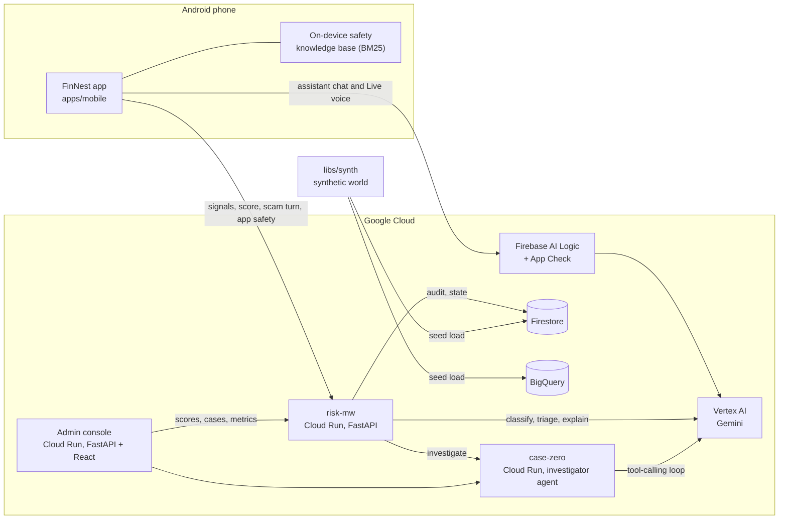
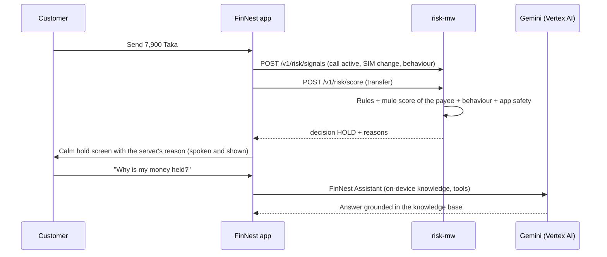

# Architecture

FinNest protects a mobile-finance customer at the moment a scam succeeds: while a fraudster is on
the phone and the customer is about to send money. The app collects device and behaviour signals,
the backend scores the transfer, and the customer gets a calm explanation in Bangla or English
before any money leaves the account.

## System view

## Components

| Path | Role |
|---|---|
| `apps/mobile` | Flutter Android app. Payments, the hold-and-explain flow, the App Safety Check, and the FinNest Assistant (text chat and Gemini Live voice with on-device retrieval). |
| `apps/console` | Operator console. FastAPI backend and React web app for scores, cases and model metrics. |
| `services/risk-mw` | Risk middleware. Scores each transaction with rules, the mule scorer, the behaviour model and the app-safety verdict. Classifies scam-call turns with Gemini. Writes the audit trail. |
| `services/case-zero` | Investigator. A Gemini tool-calling loop over the transaction graph that drafts a cited case file in English and Bangla. |
| `libs/synth` | Synthetic world generator (people, accounts, SIMs, devices, transactions, mule rings), graph tools and the mule scorer. |
| `libs/app-safety-check` | App-safety rules, the permission classifier and Play Integrity handling. |
| `libs/ato` | Behaviour (account-takeover) features and models. |
| `libs/radar` | Offline campaign radar: finds coordinated scam campaigns in the synthetic world. |
| `eval` | Cross-component evaluation runner. |
| `data` | The generated synthetic world (seed 42). |
| `models` | Trained model files that the services load. |
| `design-system` | FinNest brand tokens, fonts and web CSS. |

## A transfer during a scam call

## Design rules

- **The server owns every decision.** The app and the assistant never invent a hold reason. They
  show and speak the text that risk-mw returns.
- **The assistant reads untrusted text as data.** Caller words and app names reach the model in
  fields marked untrusted. A transcript guard removes codes, PINs and links from model output.
- **Everything works in demo mode.** Without cloud credentials the services use stubs and the app
  answers from its on-device knowledge base.
- **All data is synthetic.** The world in `data/` is generated by `libs/synth` with a fixed seed.
